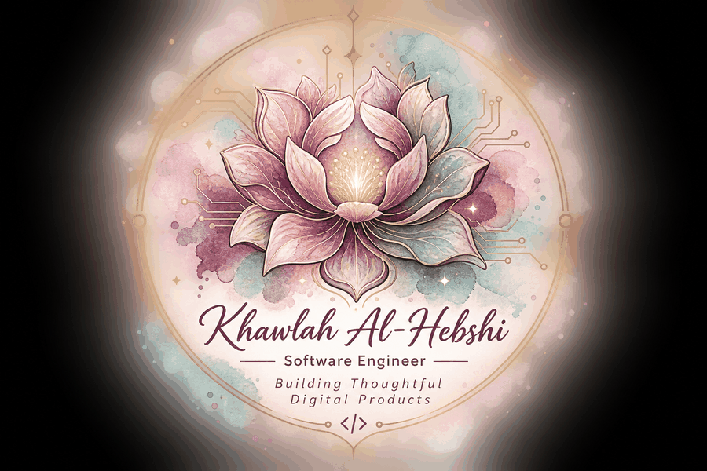

# 👟 Luxury Step — Footwear E-Commerce App (Customer Client)

**Luxury Step** is a full-featured mobile e-commerce application built with **Flutter**, **Provider**, and **Firebase**, designed to provide a premium, seamless shopping experience for footwear products.

This client application syncs dynamically with a dedicated **Merchant App**, enabling real-time order status tracking, inventory filtering, and live updates.

---

## 🌟 Key Features

* **Dynamic Product Catalog:** Fetches and displays footwear products dynamically managed via Firebase Firestore.
* **Advanced Filtering & Search:** Filter products by category, size, price range, brand, and status.
* **Real-time Order Tracking:** Tracks live order status updates (e.g., *Pending*, *Processing*, *Shipped*, *Delivered*) updated directly by the merchant.
* **Interactive Cart & Checkout:** Effortless item management, quantity updates, and streamlined order placement.
* **User Authentication:** Secure user registration, sign-in, and profile management using Firebase Authentication.
* **Custom UI & Scalable Design:** Built with custom, reusable widgets ensuring a responsive UI across various screen sizes.

---

## 🛠 Tech Stack & Architecture

* **Framework:** [Flutter](https://flutter.dev/) (Dart)
* **State Management:** [Provider](https://pub.dev/packages/provider)
* **Backend & Cloud Services:** 
  * **Firebase Authentication** — Secure identity management
  * **Cloud Firestore** — Real-time database for products and live order sync
  * **Firebase Storage** — High-resolution product image hosting
* **Architecture:** Clean Architecture principles separating UI, state logic, and data layers.

---

## 🔄 Dual-App Synchronization Workflow

```text
[ Luxury Step App ]  --->  Place Order  --->  [ Firestore DB ]
                                                     |
[ Luxury Step App ]  <---  Live Update  <---  [ Merchant App ]
```

---

## 👩‍💻 Developer & Author

<div align="center">

  

  <br/>

  

  <br/><br/>

  <a href="https://github.com/khowlah">
    
  </a>
  <a href="https://linkedin.com/in/khawlah-al-hebshi-12046a38a">
    
  </a>
  <a href="https://khowlah.github.io/Myprotofile">
    
  </a>

  <br/><br/>

  
  
  
  

  <br/><br/>

  <i>Designed with curiosity. Built with purpose.</i>
  <br/>
  <sub>✦ Personal Developer Signature — Khawlah Al-Hebshi ✦</sub>

</div>

### About Khawlah Al-Hebshi

I'm **Khawlah Al-Hebshi**, a Software Engineering graduate specializing in cross-platform mobile development with Flutter and backend engineering with Next.js. I combine clean architecture, state management discipline, and product thinking to deliver seamless mobile and web user experiences.
